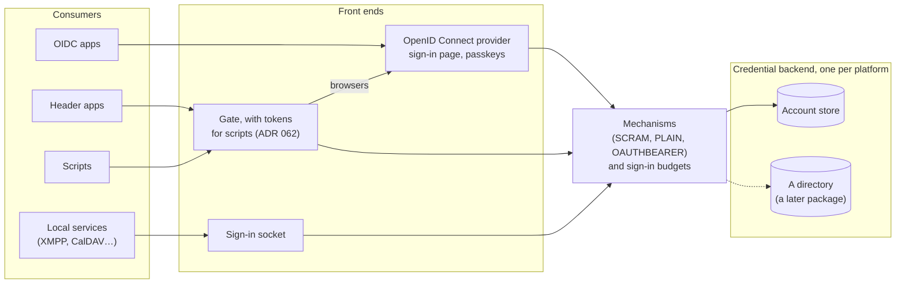

# ADR 063: Identity Layer

- **Status**: Draft
- **Type**: Feature
- **Created**: 2026-10-13
- **Revised**: 2026-10-28 (scripts use tokens exchanged at the gate, HTTP-SASL deferred; per-app users identify native callers), 2026-10-29 (OIDC apps may be gated for revocation; the provider as a module; the catalog's wiring rule)
- **Related-ADRs**: [012](./012-mfa.md) (multi-factor sign-in, deferred; passkeys take it up), [062](./062-authenticated-access-gate.md) (the access gate, which this layer extends), [061](./061-standard-roles-and-rpc-authorization.md) (the roles the layer exposes), [014](./014-authentication-bootstrap.md) (accounts and their bootstrap), [048](./048-server-config-and-secret-storage.md) (where server secrets live), [064](./064-http-sasl-at-the-gate.md) (HTTP-SASL, deferred; §5 gives scripts tokens instead), [055](./055-app-runtime-uid-separation.md) (per-app users, which identify native callers), [065](./065-workload-identity.md) (workload identity), [068](./068-guest-networking.md) (client addresses behind the proxy, and the private network between servers), [069](./069-worker-servers.md) (worker servers, which run no part of this layer)

## Context

Each app on a Hop3 server keeps separate accounts. An operator who deploys a forge, a wiki and a chat server keeps three user lists, three password policies and three places to disable someone who leaves. Hop3 itself has accounts (ADR 014), roles on them (ADR 061) and a gate that admits only signed-in users to an app (ADR 062). None of this reaches the apps. The gate tells an app who is there, which helps only apps that read a trusted header.

Apps consume identity through a handful of protocols. Most self-hosted web apps speak OpenID Connect. Some read a trusted header. Services such as XMPP, CalDAV and mail servers speak SASL (RFC 4422) and can delegate it. Scripts have no browser to complete a redirect flow.

SASL splits sign-in into three parts: a protocol transports opaque messages; a **mechanism** (SCRAM, PLAIN, OAUTHBEARER…) defines what the messages prove; a **credential backend** says whether the proof holds and for whom. Hop3 is built the same way, on plugin hooks through which any package adds builders, addons or proxies.

Three properties of the platform constrain the design: the data layer is synchronous (one database session per request); the admin domain is the only host Hop3 serves itself; server secrets are readable but not writable by the service account (ADR 048).

## Decision

We propose an identity layer in hop3-server, built on NeoZen, an open-source Python authentication library on the same stack as Hop3. NeoZen is a tool here: Hop3 embeds its core protocols (factors, OAuth and OIDC services, key and claims providers) and supplies the account repository itself.



### 1. One account store

The platform's account table is its only account store, unless a backend of §4 replaces it. It lives in the control plane, on the primary. No component keeps another one or synchronises one. No worker server holds a copy. An app learns who a user is through one of the adapters below and does not hold that user's password. Hop3 uses NeoZen's protocols; NeoZen's account storage and console stay unused.

### 2. Passwords ready for SCRAM

- A password set or change should write an Argon2id hash and SCRAM-SHA-256 credentials, in PostgreSQL's format. Older hashes are upgraded at the next successful sign-in.
- An account without SCRAM keys answers a SCRAM exchange exactly as an unknown account does, with a decoy salt derived from a dedicated server-local key, so the response does not reveal that the account exists. That key is not derived from a rotatable secret.
- `PLAIN` should be checked against the SCRAM keys when they exist. Services that relay SASL synchronously block while a password is verified, so the check must be cheap; it weakens nothing, since the keys are stored anyway.

### 3. Mechanisms are plugins

A hook adds SASL mechanisms. A mechanism is a pure step function over bytes, with explicit, opaque state that the front end keeps (in memory, for the sign-in socket). It knows nothing of HTTP, sockets, the database or the sign-in budgets; it asks the backend it is given for the credential it declared. The layer should ship `SCRAM-SHA-256`, `PLAIN` (over TLS only) and `OAUTHBEARER` over tokens Hop3 issued. These mechanisms, the SCRAM credential format of §2 and the back-channel logout of §6 are written in NeoZen, for any Python app to reuse, and registered in Hop3 through the hook. A channel-bound variant (`-PLUS`) needs binding data that the relaying service passes on; no front end of this ADR has it, so it waits for one that does. A third-party package adds a mechanism (for example DID-SASL or OPAQUE) like any plugin.

### 4. Credential backends are plugins

A second hook adds credential backends. A backend answers, for a user name: the account and whether it is active, its SCRAM credentials if it has them, and whether a password or token is valid. One backend should be active per platform, on the primary. The layer ships one, which reads the platform's account table. A directory (OpenLDAP, Active Directory, or any directory that serves LDAP, such as Kanidm's interface) would be the first other backend, added as a package outside this project. An organisation that already runs one would then keep it; Hop3 would read the accounts there.

- Mechanisms are offered by what the active backend can answer: a backend that only checks a password, as a directory does at bind, gets `PLAIN`, not SCRAM.
- A failing backend yields a diagnosis that names it. It does not show as a "wrong password".
- A disabled account is refused by all mechanisms, with the same answer and timing as a wrong password.

### 5. Front-end duties

A **sign-in socket** for local services turns transport messages into mechanism steps. It speaks Dovecot SASL, Dovecot's authentication protocol, on a Unix socket. Services that already speak that protocol, for example Prosody, Postfix or Exim, then relay their users' SASL messages to Hop3 without holding a password. Access to the socket is limited to the services that declared it. The socket knows which service calls from something the platform created: a native service by its Unix user (`SO_PEERCRED`, with the per-app users of ADR 055, Hop3 0.9), a service in a VM by its vsock socket (ADR 065). The socket is served on the primary, beside the accounts; the services that use it keep local state, so they run there, on one server, as today. Placement therefore pins an app that declares the `sasl` addon (§7) to the primary (ADR 069 §3).

**Scripts** have no browser to follow a redirect. A gated app's `Authorization` header belongs to the app, so a token there would collide with the app's own (ADR 062, open question 1). A script therefore obtains a token through the OAuth device authorization grant (RFC 8628): the person approves it on Hop3's sign-in page, passkeys included. The script exchanges the token, on a path the gate owns under each app's hostname, for the session cookie a browser gets, and calls the app with that cookie. The app never sees the token. Tokens are bound to one account, expire, and are revoked with it.

Two **sign-in budgets** limit attempts. Each front end applies both:

- **Per account.** Each password proof (the sign-in form, the API and the sign-in socket) takes one attempt from a single budget per account, so a right and a wrong password look the same once it is spent.
- **Per client address**, wherever the front end knows the client's address. Behind the proxy, the address comes only from the headers the proxy sets (ADR 068); a client cannot name its own.

A rejected attempt is logged with the account, the service, the client address and the reason; the client learns only that authentication failed.

### 6. An OpenID Connect provider

hop3-server should be an OpenID Connect provider on the admin domain, mounting only the provider's routes (discovery, keys, authorize, token, userinfo). Each platform has one sign-in issuer, on the primary, with one URL and one key set; a single server is a primary with no worker servers. A worker server never signs anyone in. A gated app running there receives the identity in the headers of ADR 062. An OIDC app running there verifies tokens with the issuer's published keys, which it fetches over the private network (ADR 068).

- Authorization code with PKCE and `nonce`; codes single-use; clients authenticate with a secret.
- Sign-in uses Hop3's page and session: one sign-in, one cookie, the same budgets.
- Clients are registered only by Hop3, from the app's recipe (§7), and are first-party: no consent page, no registration endpoint.
- The subject is a random identifier set at account creation, never reused.
- Claims hold the user name, email, and the account's groups and effective role for that app.
- A disabled account is refused at every step, and apps that support it receive a back-channel logout; apps that do not are gated (§7).
- Signing and token-hashing keys are separate installer-managed secrets, included in the primary's backup, rotated by the operator.
- Apps reach the provider server to server, so the admin domain must lead to the primary from every server, over the private network from a worker server, and present a certificate the apps trust; a deploy checks this and stops with a diagnosis when it fails.

### 7. Identity is an addon

A recipe asks for identity as it asks for a database:

```toml
[[addons]]
type = "oidc"
callback-path = "/oauth2/callback"
```

The platform registers a client with one redirect URI per hostname of the app, refreshes the URIs when hostnames change, hands the app the issuer, client and secret through environment variables, and deletes the client with the app. A service that speaks SASL declares the sign-in socket the same way (`type = "sasl"`). An app that reads a trusted header relies on ADR 062 instead. An OIDC app may also be gated: the gate and the provider share one session (§6), so a person signs in once, and the gate refuses a disabled account on the next request whatever the app's own session does. Golden apps without back-channel logout are gated by default; the recipe excludes the paths the app's non-browser clients use, which keep the app's bound.

The catalog is wired by one rule. An app uses OpenID Connect if its released version supports it, otherwise the gate; a service uses SASL. An app that fits none stays in the golden set, listed without single sign-on, and a patch is sent upstream where a small change would open a sign-in path, without waiting for its merge. No app is changed beyond its recipe.

Roles and groups are Hop3's. A role (ADR 061) is how much authority an account holds; a group (`staff`, `developers`) is which kind of user it is, named by the operator. An app's access list names groups; an empty list admits all active accounts. Each app maps groups and roles in the app's configuration, so Hop3 keeps no per-app vocabulary.

### 8. One process

The layer runs in hop3-server's process, on the primary. A separate identity service would mean a second service to run and an account store to keep in sync, which is what small operators cannot afford. The price is attack surface, so only the provider's routes are mounted and only clients Hop3 registered are accepted. A compromise of hop3-server is already total (ADR 041), so the provider adds exposure, five routes on an admin domain hop3-server already serves, and no new blast radius. The provider is a module with its own routes; running it as a separate process behind the same proxy, on the same database, is a packaging change, kept open for a security audit to decide. Leaving the embedded provider is supported: accounts and groups export through SCIM; a deploy re-registers each app's client against an external issuer named in the platform's configuration, since the recipes hold the wiring (§7).

### 9. Passkeys

Passkeys (WebAuthn) should be a factor of Hop3's sign-in page, taking up ADR 012. NeoZen provides the WebAuthn ceremony; Hop3 keeps each account's passkeys with the account. A passkey is a browser ceremony, not a SASL mechanism: it signs a user in to the page, and through it to all OIDC and gated apps. Scripts and the users of local services cannot perform it. A script uses the device grant (§5); a user of an XMPP or CalDAV service keeps a password, or presents a token Hop3 issued through `OAUTHBEARER`. A failed passkey assertion counts against the per-client budget.

## Acceptance

- The platform's account table is the only account store on a fresh platform.
- On a platform with a worker server, a gated app there receives the identity headers of ADR 062, an OIDC app there signs a user in and verifies tokens with the issuer's keys over the private network, and the worker server holds no account data.
- RFC 7677's SCRAM-SHA-256 test vector passes; stored credentials match PostgreSQL's format.
- SCRAM against an account without keys and against an unknown account give identical answers.
- A script obtains a token by the device grant, exchanges it at the gate for a session and calls a gated app; the app's own `Authorization` header arrives untouched; an expired or revoked token is refused.
- On the sign-in socket, a service's name comes from the Unix user or VM socket it calls from; a name claimed in the protocol changes nothing.
- A failing backend surfaces as a diagnosis, never as a wrong password.
- Every password proof path shares one per-account budget, checked by one test that enumerates them; a client address that did not come from the proxy is never counted as a client.
- The OIDC flow with PKCE and `nonce` passes; a code is single-use; a disabled account is refused at every step; no route outside the provider's is mounted.
- Disabling an account sends a back-channel logout to each OIDC app that supports it; the app ends the session within a delay measured per app.
- A user signs in with a passkey and reaches an OIDC app; a passkey registered for another origin is refused.
- An app destroyed leaves no client; an app restored keeps signing in.
- Each security property above fails its test under a planted regression.

## Consequences

### Positive

- One account for every app on the platform, and one place to disable it.
- A mechanism written once serves every front end: web, XMPP, CalDAV, mail.
- Other projects add mechanisms or backends as packages, without a fork.
- Identity wiring is a line in the recipe, created and removed with the app.

### Negative

- An internet-facing provider shares the control plane's process.
- hop3-server depends on NeoZen, whose services are asynchronous while Hop3's data layer is synchronous; the bridge between them is a source of defects to test.
- Two verifiers are stored per password. SCRAM keys are as sensitive as a password hash.

## Alternatives considered

- **A separate identity server**, such as Keycloak, Authentik, Kanidm or Canaille, buys isolation and mature features. It costs a second service and an account store kept in sync with Hop3's roles. These are applications; Hop3 needs a library inside the control plane. Such a server can still hold the accounts, as a backend behind §4.
- **HTTP-SASL at the gate** ([ADR 064](./064-http-sasl-at-the-gate.md)) lets scripts sign in with SCRAM over HTTP, bound to the TLS channel. Its Internet-Draft expired in 2023 and no other implementation is in sight. It is deferred; the mechanisms of §3 would serve it unchanged.
- **NeoZen as its own process** on the same database buys isolation from the control plane. It costs an interface, a second sign-in and a unit to supervise. A security review that rates the shared process unacceptable would change this choice.
- **A C SASL engine**, such as Cyrus SASL, brings Kerberos and many mechanisms. It costs a native build chain and bindings on every target. A mechanism Hop3 needs that only such an engine provides would change this choice.

## Open questions

1. **External backends and Hop3's roles.** With a directory as the backend, does an account's role and subject live in a local row created at first sign-in, or is it mapped from the directory on each request? Decided with the first external backend.
2. **SCRAM iteration count.** RFC 7677's floor is 4096; a higher default costs each sign-in and each password set. Decided by measurement on small servers.
3. **Mapping groups to each app's roles.** Whether the recipe or the operator maps Hop3's groups to an app's roles. Decided on the apps wired first.
4. **Passkeys alone or beside a password.** An account with only passkeys reaches scripts through the device grant (§5), but has no password for local services such as an XMPP client, so it needs an app password or a token. Decided with the first apps wired.
5. **Recovery when a device is lost.** A second passkey, recovery codes, or a reset by an administrator. Decided by the operators' feedback.
