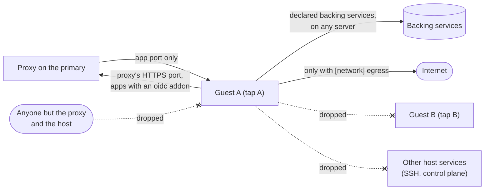
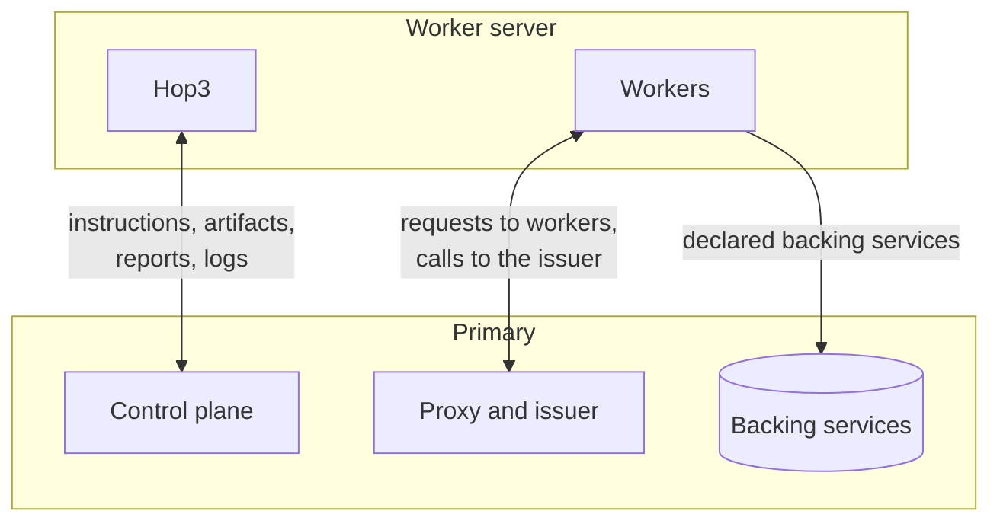

# ADR 068: Platform Networking

- **Status**: Draft
- **Type**: Architecture
- **Created**: 2026-10-27
- **Revised**: 2026-10-29 (inbound traffic from the proxy or the host's health check; the build guest's allow-list; peers updated at enrolment, rotation and removal)
- **Related-ADRs**: [041](./041-privileged-operations-agent.md) (the privileged helper, rootd, which writes the rules and sets up the private network), [045](./045-fixed-port-registry.md) (declared ports and the per-app firewall rules the privileged helper writes for them), [063](./063-identity-layer.md) (per-client sign-in budgets), [065](./065-workload-identity.md) (workload identity over vsock, and the key that admits a worker server to the private network), [067](./067-microvm-execution-backend.md) (the micro-VM backend), [069](./069-worker-servers.md) (worker servers and placement)

## Context

A micro-VM isolates nothing until its network does. A guest with a network device and no policy can connect to anything the host can: the host's services (SSH, the control plane, every database), the other guests and the internet. A bare tap device is as open as a monitor's default user network; isolation is entirely in the rules applied to it.

An app in a VM needs three kinds of traffic:

- **Inbound requests**, which must come only through Hop3's reverse proxy.
- **Its addons** (PostgreSQL, MySQL, Redis), which run on the primary by default or on a server of their own, and must be reachable only by the apps that declared them.
- **Platform services** (the sign-in socket, the guest agent), which must know which app is calling.

A fourth is optional: outbound access to the internet, which some apps need (fetching feeds, sending webhooks) and most do not.

Natively, the proxy reaches the app on loopback, so every request arrives from `127.0.0.1` and the app never sees the real client. Per-client limits in the app (sign-in budgets, rate limits) then count the proxy as one client.

A platform with worker servers (ADR 069) moves the same boundary between servers. The proxy, the issuer and, by default, the backing services stay on the primary, while workers run on any server. Traffic between servers crosses a provider's network or the internet, so it must be encrypted and must reach only the platform's own endpoints. Loopback stops being special between servers, as it did between a host and a guest.

## Decision

We propose one tap per VM, closed by default, with rules the platform derives from the recipe, and one private network between the servers of a platform, reserved for the platform's own traffic.

### 1. One tap per VM

Each VM gets one tap device on the host, created by the privileged helper at the app's start and named after the app. The monitor attaches to it; it never creates network devices itself.

### 2. Rules before boot

The privileged helper writes the VM's nftables rules **before** the monitor starts and removes them after it stops. A VM started before the rules exist is open for that interval, so the launcher refuses to start the monitor until the helper confirms the rules. Unlike ADR 045's best-effort rules, a VM never starts without them. The rules, per tap:

- Inbound to the guest: only to the app's port, and only from the proxy's address (on a worker server, the primary's address on the private network) or from the host that holds the guest, which runs the health check (ADR 069 §1).
- From the guest: established traffic, and new connections only to the addresses and ports of the backing services the app declared, on whichever server they run (§9).
- An app that declares an `oidc` addon may also reach the HTTPS port of the proxy on the primary, where it calls the provider's back channel at the issuer's URL, as any client does. This exposes nothing a client on the internet cannot already access.
- From the guest to anywhere else: dropped, unless the app declares outbound access (`[network] egress`), in which case it is forwarded and masqueraded, and DNS is answered by a resolver the platform chooses. A build guest gets egress to an allow-list of destinations instead (ADR 071 §3).
- Forwarding between taps: always dropped, so guests cannot talk to each other.

The rules live in a Hop3 table beside the per-app firewall rules of ADR 045, and the server's reconcile at startup removes rules for apps that no longer exist.

### 3. Addresses

The platform allocates each VM a small subnet from the range of the server that runs it. The control plane gives each server a separate range from the platform's configuration, in the reply to its `enrol` message (ADR 069 §1), so guest addresses are unique across the platform. It records the subnet with the app and frees it at destroy. The guest learns its address and the host's from the kernel command line; no DHCP runs. Addon URLs injected into the app's environment name the backing service's platform address (§9), routed through the guest's host.

### 4. The proxy targets the guest

The proxy's upstream for a VM app is the guest's address and port. The host forwards no loopback port and listens on nothing for the app. For a guest on a worker server, that address is routed over the private network (§8).

### 5. The real client's address

Hop3's proxy sets the client address headers (`X-Forwarded-For`, `X-Real-IP`, `Forwarded`) itself, overwriting any a client sent. The app's environment names the proxy's address as the only trusted proxy, so an app that honours these headers sees the real client. A request that does not come from the proxy cannot forge one. The platform's sign-in front ends, whose per-client budgets ADR 063 §5 defines, receive the same address. The same applies to native apps, where the trusted proxy is loopback on the primary and the primary's private address on a worker server.

### 6. Platform services over vsock

Platform services that must know the caller are not reached over the network. Each is relayed into the guest over vsock (ADR 065), where the host knows the caller by the socket the connection arrived on. Platform services need no network route.

### 7. Teardown

Destroying or stopping the app removes the app's tap, rules and address allocation. Removing a worker server removes the server's peer, routes and rules from the primary. A leftover is a defect the catalog's blank-slate runs detect.

### 8. A private network between servers

The primary and each worker server are joined by WireGuard. The privileged helper on each server sets up the interface and its peers, as it sets up taps, from the keys enrolled under ADR 065 §4. Enrolling a worker server adds it as a peer of the primary. Rotating its key replaces the peer's key (ADR 065 §6). Removing it removes the peer. Worker servers are not peers of each other: while the backing services stay on the primary, no flow of the platform runs between two of them. A server that holds backing services joins the same way; whether the worker servers peer with it or go through the primary is open question 4.

Each server holds one address on the private network, from a range in the platform's configuration, assigned when the operator enrols it (ADR 065 §4). The private network also routes each server's guest range (§3) to that server, so the proxy's upstream for a guest on a worker server stays the guest's address (§4). A single server holds a private address too, with no peers, so the code paths are the same with and without worker servers.

On each server, rules on the private interface admit only the platform's flows:

- the proxy on the primary to the workers' ports;
- workers to the ports of backing services, and to the proxy's HTTPS port for the issuer;
- the control plane to the worker server for signed instructions;
- the worker server to the control plane for reports and logs;
- the worker server to the primary's artifact cache, for the artifacts and Nix store paths of the workers placed on it (ADR 069 §2).

Everything else is dropped: SSH and the other ports of a server stay closed to the other servers.

### 9. Addresses valid from any server

Workers reach backing services and the issuer by addresses valid from any server:

- A backing service listens on the private address of the server that runs it. An app's environment names that address in the service's URL, so the URL stays valid when placement moves a worker to another server.
- The proxy on the primary also listens on the primary's private address, to which the admin domain resolves inside the platform. A worker then calls the issuer at the same URL from any server, over the private network from a worker server.
- A native worker on a worker server binds its port on that server's private address, which is the proxy's upstream for it. A VM worker keeps the guest's address (§4).
- Guest rules (§2) name backing services by these addresses, which hold on whichever server the service runs.

## Acceptance

- From inside a guest: the ports of the app's addons are open; another host port, another addon, another guest, SSH and the internet are closed; each case is a test, run on every release.
- A guest whose app declares `egress` can connect to the internet; the host's other services stay closed to it.
- Starting a VM whose rules were not written fails with a diagnosis; no VM is ever reachable without them.
- A request sent directly to a guest's address from anywhere but the proxy or the guest's host is dropped.
- An app behind the proxy sees the client's real address; a client-supplied `X-Forwarded-For` does not reach it.
- After destroy, no tap, rule or address of the app remains.
- On a platform with a worker server, the proxy on the primary routes requests to a native worker and to a VM worker there. A worker there connects to the app's backing services and to the issuer by the same URLs as on the primary. A guest there connects only to the backing services its app declared.
- Between servers, flows not listed in §8 are dropped, and no backing service listens on a public address. A server the operator did not enrol cannot join the private network.
- After a worker server is removed, no peer, route or rule for it remains on the primary.

## Consequences

### Positive

- An app can connect only to what it declared, which makes the VM's isolation real.
- Per-client limits in apps and in the sign-in front ends count real clients.
- The platform derives the policy from the recipe as data, so the operator has nothing to configure.
- A worker uses the same addresses from any server, so placement moves it without changing the app's configuration.
- Traffic between servers is encrypted and limited to the platform's flows, with no VPN for the operator to run.

### Negative

- The privileged helper gains a `net.*` family of operations (tap, rule set, the private interface and its peers), added by amendment to ADR 041, as its §18 and §19 added the `cgroup.*` and `proxy.*` families, and takes part in VM starts and enrolments.
- A VM start depends on nftables being available on the host.
- Apps that need outbound access must say so; an undeclared one fails at the first connection, with an error the operator must read.
- A worker on a worker server pays a network round trip per query to a backing service on the primary; placement keeps the workers of an app with a database addon near the primary by default (ADR 069 §3).
- Servers need WireGuard in the kernel (mainline since Linux 5.6).

## Alternatives considered

- **The monitor's user-mode network** (QEMU `restrict=on` with forwards) needs no host changes. It costs throughput, is QEMU-only, and keeps the proxy on forwarded loopback ports.
- **One bridge for all guests** needs fewer devices. It puts guests on one segment, so isolation between them depends on more rules.
- **Network namespaces per VM, without rules,** separate by construction. They cost a veth pair and routing per app, and still need rules for the addons.
- **Addons inside the guest** remove host access entirely. They cost one database server per app.
- **A provider's private network** (Hetzner vSwitch, OVH vRack) between servers needs no tunnel. It ties the platform to one provider, and traffic on it is not encrypted. An operator whose servers all share one such network, and who accepts the provider in the threat model, would change this choice.
- **TLS on each connection** (the proxy to workers over HTTPS, PostgreSQL and Redis over TLS) encrypts with no network layer. It costs a certificate per service and a configuration per protocol, and leaves the other ports of a server reachable from the other servers. Servers that cannot run WireGuard would change this choice.

## Open questions

1. **DNS.** A resolver per server for guests with egress, or the host's resolver forwarded. Decided with the first app declaring egress.
2. **IPv6** for guests, and whether egress is per protocol. Decided by host providers' IPv6 support.
3. **Outbound allow-lists for apps.** The build guest already has egress by destination (ADR 071 §3). Whether a recipe may declare one for an app, rather than all-or-nothing egress, is decided by the first app whose egress must be narrowed.
4. **Backing services on a server of their own.** Whether that server is a peer of the worker servers, or they reach it through the primary at the cost of a second hop. Decided by the first platform that places backing services away from the primary.
