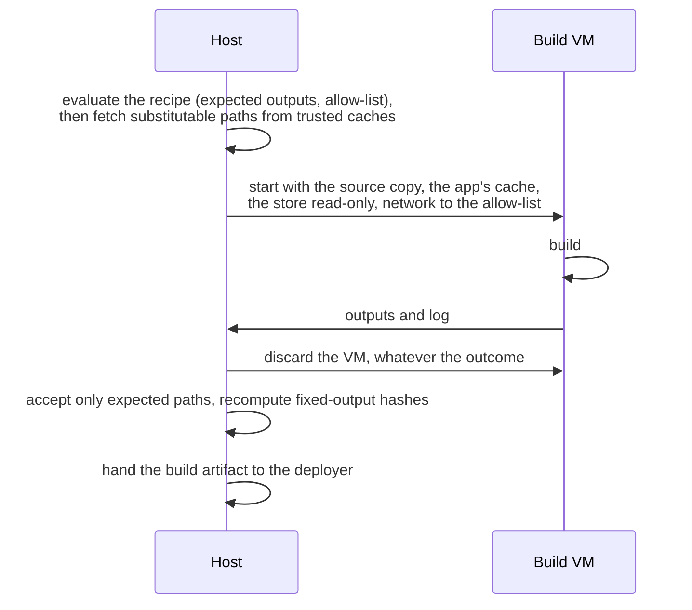

# ADR 071: Sandboxed Builds

- **Status**: Draft
- **Type**: Architecture
- **Created**: 2026-10-27
- **Revised**: 2026-10-28 (a primary with hardware virtualisation sandboxes the builds of the whole platform; ADR 055's plan for builds), 2026-10-29 (the host fetches from the binary caches before the build; release hooks in a one-shot instance)
- **Related-ADRs**: [013](./013-supply-chain.md) (supply chain and build provenance), [041](./041-privileged-operations-agent.md) (privileged operations), [053](./053-nix-closure-lifetime.md) (Nix closures), [058](./058-build-reproducibility-model.md) (the build artifact and its reproducibility), [067](./067-microvm-execution-backend.md) (the micro-VM guest a build reuses), [068](./068-guest-networking.md) (platform networking: the build guest's tap and rules), [069](./069-worker-servers.md) (worker servers, which receive the build artifact)

## Context

Deploying an app runs the recipe's code: build hooks (provided by plugins), package managers' install scripts, Nix expressions, `before-build` commands. Today that code runs as the `hop3` user, the platform's service account. A malicious or compromised recipe or dependency therefore reads every app's data and secrets, and reaches the control plane's database and the privileged helper. ADR 055 plans to run build steps as the app's own user, which separates files but keeps the host's kernel and network. Deploying an app is admin-equivalent ([security model](../security/security-model.md) §1.4).

Isolating apps at run time (ADR 067) does not close this: the build runs before the app has a VM, on the host.

Builds have needs a running app does not: network access to fetch sources and dependencies, a cache which persists between builds (without it, every deploy rebuilds from nothing and a Nix build fetches gigabytes), and outputs that the host must accept.

## Decision

We propose that every build run in a throwaway micro-VM, with the host deciding what it accepts back.

### 1. Each build in a throwaway VM

A build runs in a fresh micro-VM, with the same guest kernel, initrd and init as ADR 067, discarded when the build ends, whatever the outcome. The build's output and log are returned to the host; nothing else leaves the guest. The deployer starts the build guest's monitor as the app's user, as ADR 067 §5 does for the run-time guest. An escape from the guest then gains no more than the app's own files. That user holds `/dev/kvm` access from its creation (ADR 067 §6).

### 2. The build guest's view

- The app's source tree, copied in, writable.
- The build cache for this app (§4), writable.
- For Nix builds, the host's store read-only.
- None of any app's data or files, and only the secrets the recipe declares for the build.
- No platform service (the sign-in socket, addons, RPC).

Release hooks that need the app's services (migrations against the database) run after the build, once, on the primary, in a one-shot instance of the new release (ADR 069 §2). For a VM app, that instance is a one-shot guest with the run-time mounts (ADR 067 §4); for a native app, it is a process as the app's user. They never run in the build guest.

### 3. Network only to fetch

The build guest's network (ADR 068's tap and rules) reaches only an allow-list of the source hosts and package registries the toolchain needs (declared per toolchain, extendable per recipe). For Nix, the host fetches the substitutable paths itself before the build (§4), so the guest's allow-list is derived from the evaluation: the URLs of the fixed-output derivations and nixpkgs' mirrors. The host, other guests and the rest of the internet stay unreachable.

### 4. A cache that persists

- **Nix.** The guest builds against the host's store read-only, through an overlay; the VM is the sandbox. Before the build, the host fetches the substitutable paths of the evaluated closure from the caches it trusts, so the guest builds only what no cache has. After it, the host imports only the outputs its evaluation expects, checks each path and recomputes fixed-output hashes. An output built from an ordinary derivation cannot be checked by content, so it is trusted as a build of that app and no further.
- **Native toolchains.** Each app has separate cache directories (pip, npm, Maven, Cargo…), mounted into the app's build guest. A cache is never shared between apps, so one app's build cannot poison another's.

### 5. The output is the build artifact

Only the build artifact the deployer already consumes (`runtime.json` and the files it names) crosses back. The deployer runs it natively or in a VM, unchanged.

Builds run on the primary, beside the cache of build artifacts; a separate build server may take them over later. A worker server never builds: it receives the artifact when placement starts the app's workers there (ADR 069). A primary with hardware virtualisation therefore sandboxes every Nix build of the platform, including those of apps whose workers run natively on worker servers without it, such as rented VPS.

### 6. Nix first

Nix builds are sandboxed first: their inputs are declared and their downloads are fixed-output and checkable. The host can also compute what a build must produce before it runs. Native toolchains follow, one at a time, each with its allow-list and cache directories.

## Acceptance

- A build step that tries to read another app's directory, the control plane's database or a secret file fails, in a test run on every release.
- A build step that connects to a host not on the allow-list fails; fetching a declared source succeeds.
- A second build of an unchanged Nix app takes a fraction of the first's time, measured and published.
- A path the host's evaluation did not ask for, or a fixed-output path whose content does not match its declared hash, is refused.
- The golden Nix apps build in sandboxed builds and pass their checks.

## Consequences

### Positive

- Deploying an app no longer grants the recipe the platform's authority.
- The boundary reuses the run-time guest, so there is one guest to harden.
- Per-app caches remove a cross-app interference path that exists today.
- One server with hardware virtualisation, as the primary, is enough to sandbox the Nix builds of a platform whose worker servers are VPS.

### Negative

- Each build pays a VM start and the copy of the source tree and output.
- Per-app caches take more disk than one shared cache.
- Allow-lists must be maintained per toolchain. A build fetching from an undeclared host fails until the host is declared.
- A primary without hardware virtualisation keeps unsandboxed builds, reported as such (open question 5).

## Alternatives considered

- **Nix's own sandbox** (namespaces, a build user) already isolates Nix derivations. It shares the host's kernel and does not cover native toolchains or recipe hooks.
- **A per-app Unix user for builds** (ADR 055) is cheap. It separates files only, with the same kernel and network.
- **A separate build server** moves the risk off the primary, where the control plane runs. It costs one more machine per operator. An operator whose builds slow the primary's other work, or whose primary cannot run VMs, would change this choice.

## Open questions

1. **Trusting built outputs.** Whether outputs are signed by the build guest, and with which key. Decided when the first native toolchain is sandboxed.
2. **Cache poisoning within one app.** A compromised build can poison that app's cache for the next build; whether caches are rebuilt on a schedule or verified. Decided by the cost of a cold rebuild, measured.
3. **Time cost.** The acceptable overhead per build, and whether a warm guest pool is worth its memory. The target to beat: about 4.5 s of fixed cost per build, and compilation about twice as slow as on the host. Decided by measurement.
4. **Derivations shared by several apps and in no binary cache.** One app's build could place a poisoned output another app then uses. Built per app, rebuilt and compared (`--check`), or content-addressed derivations once Nix supports them. Decided by how often golden apps share such derivations.
5. **A primary without hardware virtualisation.** Whether a primary that cannot run VMs may build third-party recipes at all, or only with the operator's explicit opt-in, since builds there run unsandboxed. Decided before sandboxed builds ship, and revisited with ADR 067's platform default (open question 1 there).
