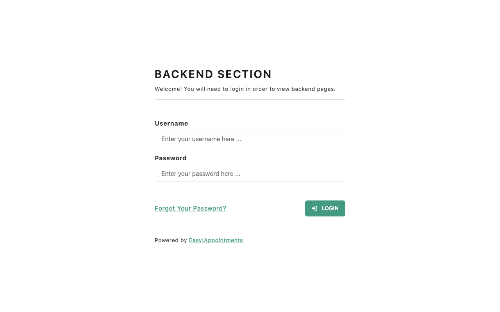
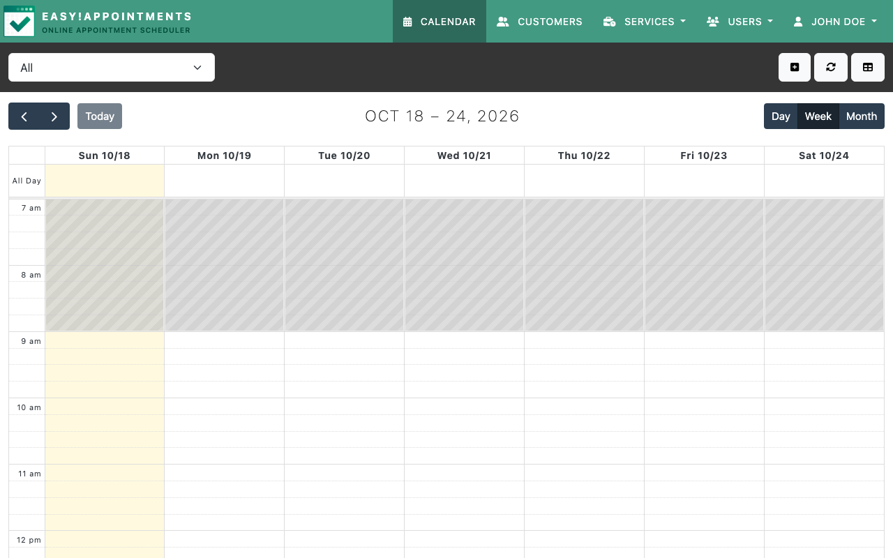

# Experience Report: Easy!Appointments

Open source appointment scheduling.

## What this app exercised

Whether the sign-in bar can be met by an application that builds its login form in JavaScript. It can, by a browser: on 2026-10-18 the harness signed in to both variants and photographed the calendar behind the sign-in.

## What broke

**The login form is built in JavaScript**, so the served page has no inputs at all and an HTTP check cannot sign in. In July the browser harness could not either, on the template variant: it filled the form, submitted, and was still looking at it afterwards. On 2026-10-18 it signed in. Which change ended the failure was not isolated; in between, the variant moved from PHP's built-in server to php-fpm (2026-09-30).

**The git tag is not the release.** It omits both the minified frontend assets and `vendor/`, so a package built from it is missing part of the application.

**`BASE_URL` was built by hand as `http://${HOST_NAME}`**: right host, wrong scheme. The app constructs its login POST from that constant, so on an HTTPS site the browser was asked to submit over a scheme the page cannot use.

## What the platform gained

`unzip` on `buildComposerProject`'s `nativeBuildInputs` when the source is a zip, in the `php-app` template.

## Deployment variants

Every variant takes the upstream *release* archive instead of the git tag. The archive is a flat zip, so `source-root` is `"."`; it already ships 27,549 `vendor/` entries, so composer is switched off.

## Verification

`apps/easy-appointments/check.py` checks everything an HTTP client can and leaves the sign-in to a browser, saying so. `hop3-test run --screenshots` signs in with the `[admin]` credential in a real browser and fails the test if it cannot; a run without a browser reports the app as not verified rather than passed. The recipe declares no `[probe]` account, so what is verified is the operator's administrator sign-in.

## Reproduce

```bash
hop3 catalog install easy-appointments
hop3 app check --app easy-appointments
```

## Open

- **No wrong-password check.** The browser verifies that the right credential signs in; nothing verifies that a wrong one is refused, which `check.py` does for every app whose form it can post.

## Screenshots



