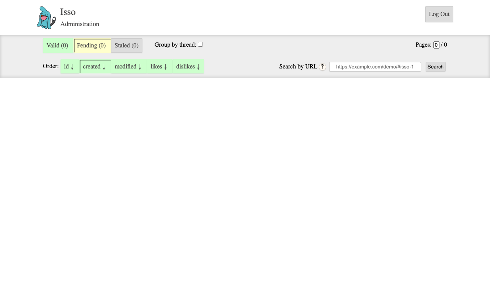

# Experience Report: Isso

A lightweight commenting system, Disqus alternative.

## What this app exercised

A comment widget whose `/` is an API. Its moderation dashboard is password-only: there is no account to name.

## What broke

**It was served with its moderation dashboard disabled.** The hand-written Nix config had no `[admin]` section at all, so `/admin/` answered without ever asking for a password. The check reported *"the admin dashboard is not asking for a password"*. It was right: there was no dashboard to ask. Isso has no admin username, so the password is the whole credential. Its absence leaves the dashboard open.

**Comments were self-publishing.** Without `[moderation] enabled`, any anonymous visitor's comment appears immediately, which is Isso's equivalent of open registration.

**Its JavaScript 404s.** The `python-venv` template has no frontend build phase, so the admin dashboard's assets are not built. The page answers 200 and a `contains` assertion passes on it. Content assertions are not verification.

## What the platform gained

No platform change. The contribution is evidential: the argument for the sign-in bar, made in one line of config.

## Deployment variants

Isso is absent from `python3Packages`, so every variant pip-installs it. The Nix ones do so into a sealed venv from a hash-pinned requirement set. It uses SQLite and needs no addon, which makes it the lowest-friction app in the corpus and a useful control.

## Verification

`apps/isso/check.py` signs in with the `[admin]` credential and confirms a wrong password is refused. It has no `[probe]` account, so it signs in as the operator's administrator: the weaker claim, since that password can be changed out from under it.

## Reproduce

```bash
hop3 catalog install isso
hop3 app check --app isso
```

## Open

Nothing open.

## Screenshots



