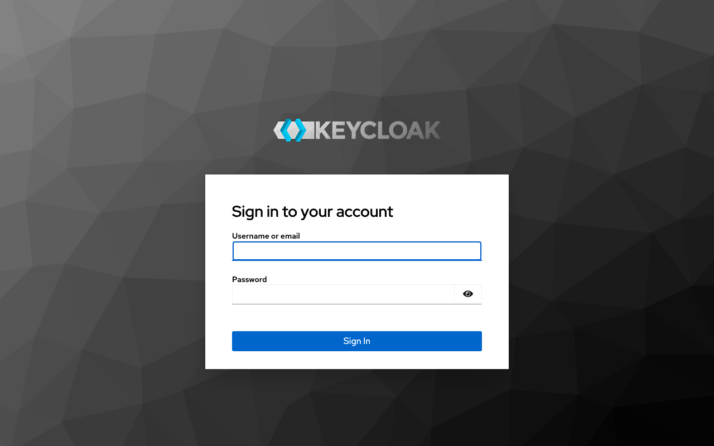
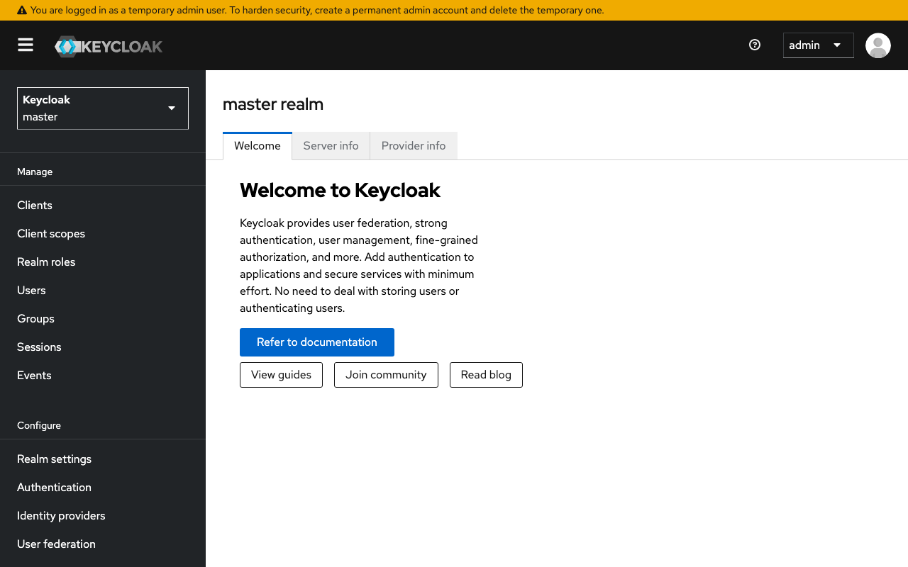

# Experience Report: Keycloak

Enterprise SSO / OIDC / SAML identity and access management.

## What this app exercised

An identity provider with no login form to post: its check obtains an OIDC token instead. It is also the first consumer of `writable-home-at-runtime`.

## What broke

**The generated Nix expression did not evaluate.** `extra-paths` referenced `${keycloak}`, but the let-binding is derived from the app id, so in the `keycloak-nixgen` variant it is `keycloak_nixgen`. The recipe had been made by copying and renaming, which renamed the binding underneath it. Nix failed at *build* time with `undefined variable 'keycloak'` and pointed at a generated line no one wrote.

**The admin console's sign-in redirect pointed nowhere reachable.** `KC_HOSTNAME` was absent, so Keycloak built its OIDC issuer, redirect URIs and console asset paths from the address it believes it is served on (behind nginx, `http://0.0.0.0:<port>`). The console loaded and never rendered a form, while `/realms/master`, which needs none of that, answered 200 throughout. It needs the public URL and `KC_PROXY_HEADERS=xforwarded` so the scheme Keycloak uses matches the one nginx terminated.

**The realm shipped with a published administrator password.** `KC_BOOTSTRAP_ADMIN_PASSWORD = "changeme"` was a literal in the recipe. Nothing mapped Hop3's generated credential onto it. The deployed instance had an administrator whose password is in the repository, while the operator was handed one that did not work. The smoke test reported only the second half of that.

## What the platform gained

`writable-home-at-runtime` and `[nix.env-exports-raw]` were both built for this app and both are in use elsewhere. It established the escape hatches' purpose.

## Deployment variants

It is the hardest consumer of the Nix escape hatches. Quarkus rewrites `lib/quarkus` on every start, so the package is the app's writable tree, copied into `src/` at deploy time, and `lib/quarkus` is a scratch volume. Nixpkgs' `kc.sh` is a compiled Go wrapper hardcoding a path back into the read-only store, so the raw upstream script is exec'd instead. That script falls back to `java` on `PATH` unless `JAVA_HOME` is interpolated at Nix build time, which is what `[nix.env-exports-raw]` exists for.

## Verification

`apps/keycloak/check.py` authenticates as the `[probe]` account, which Hop3 owns and rotates (by obtaining an OIDC token, since Keycloak serves no login form to post). It confirms a wrong password fails to obtain one.

## Reproduce

```bash
hop3 catalog install keycloak
hop3 app check --app keycloak
```

## Open

Nothing open.

## Screenshots

 
