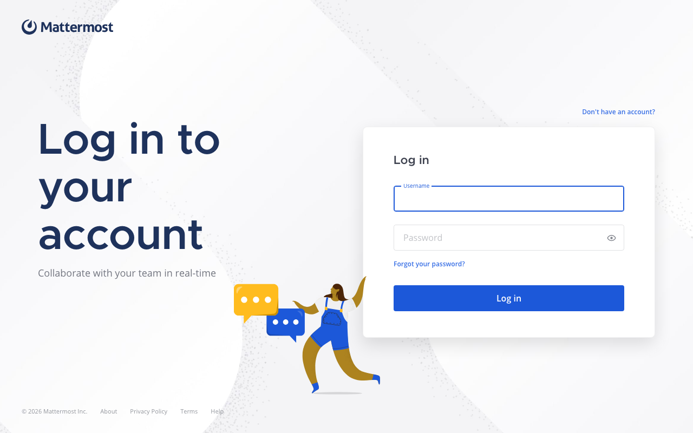
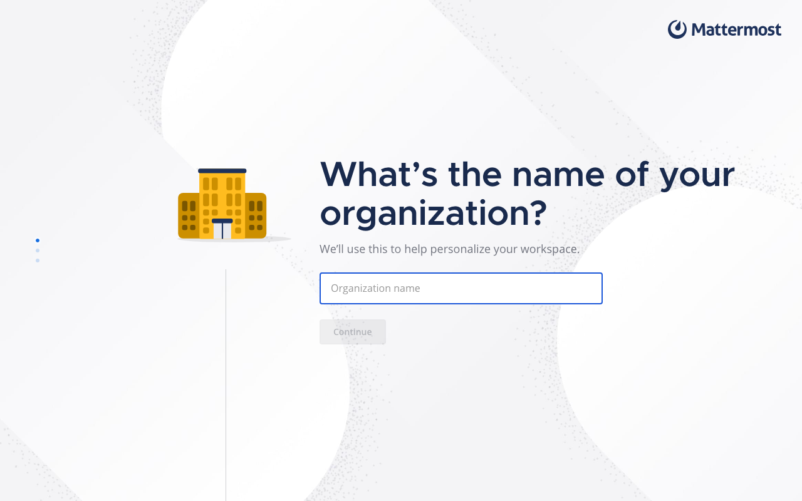

# Experience Report: Mattermost

Open source team collaboration platform.

## What this app exercised

A nixpkgs derivation does not ship the tools its application's documentation assumes.

## What broke

**Every `mmctl --local` call in the account bootstrap exited 127.** The `mattermost` package's `bin/` holds only `mattermost`; `mmctl` is a separate package and has to be asked for by name.

**`SiteURL` pinned to localhost** left the webapp loading against an origin the visitor does not have. The REST check (a POST to `/api/v4/users/login`) passed throughout, so the failure was visible only to a browser.

**Its web client lives apart from the binary.** Mattermost finds its templates, fonts and translations beside its executable, which under Nix resolves into the store. The web client is another nixpkgs output, at the package's top level, and has to be linked into the working directory, under a `client/` that stays writable for plugins.

**The Nix variants served no web client from their import until 2026-10-18.** Both linked the assets from `share/mattermost/`, which the package does not have. Nothing was linked. Every page answered `open .../client/root.html: no such file or directory`. The REST ping and the REST sign-in passed throughout; the browser harness's images showed the error line. Each recipe now links the client entry by entry and stops the deploy if `root.html` is missing, and a validation checks that `/login` serves the client.

## What the platform gained

`[nix.let-extra]`, which lets a recipe pull a second nixpkgs package into its derivation; Vikunja and Keycloak both use it.

## Deployment variants

**Nix (hand-crafted)** wraps nixpkgs' `mattermost` and pulls `mmctl` in as a second package; **Nix (template-generated)** does the same through `[nix.let-extra]`. Both link the package's web client into `client/`; the other assets are found through the binary's path.

## Verification

`apps/mattermost/check.py` signs in with the `[probe]` account, which Hop3 owns and rotates, and confirms a wrong password is refused. It does so over the REST API, which passes without a web client, so a validation also checks that `/login` serves the client's page, and `hop3-test run --screenshots` signs in with a browser. A fresh browser is first sent to a "View in Desktop App / View in Browser" page, which the harness clicks through.

## Reproduce

```bash
hop3 catalog install mattermost
hop3 app check --app mattermost
```

## Open

Nothing open. Every variant is photographed signed in (2026-10-18).

## Screenshots



